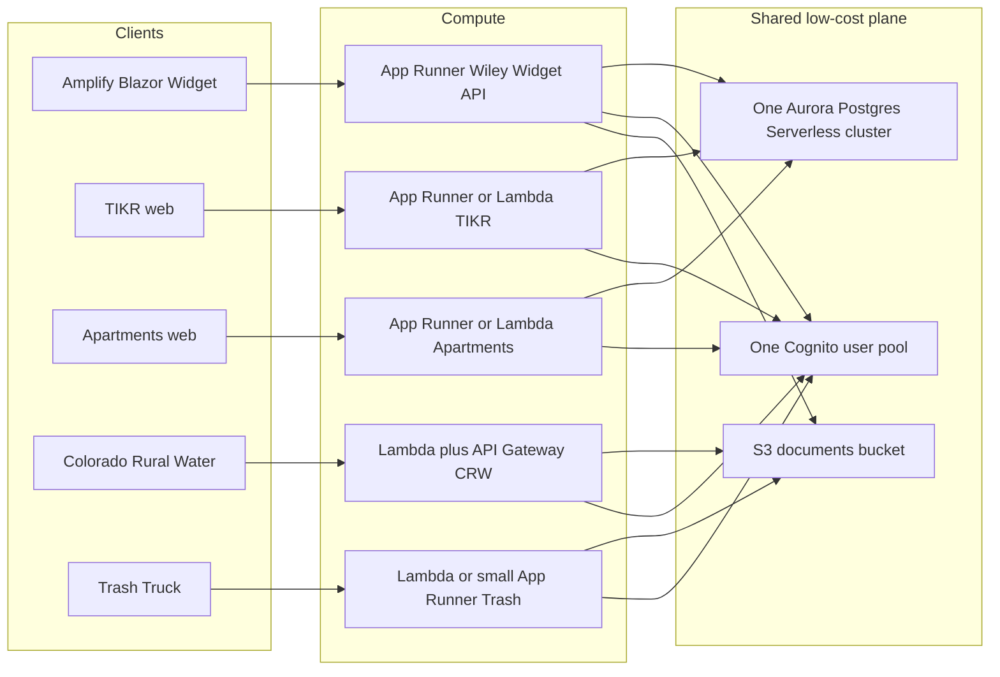

# AWS low-cost architecture (four-system suite)

How to host the Town of Wiley application suite on AWS while keeping **monthly cost roughly under $50–80** at current (low) volume.

Audience: operators and agents planning infra for Wiley Widget, TIKR, Wiley Apartments, Colorado Rural Water, and Trash Truck. This is an architecture target, not a deploy runbook.

Status date: 2026-11-08 (updated same day for Town Hub / shared-contracts PR).

Related: [`post-production-operations-handbook.md`](post-production-operations-handbook.md), [`shared-contracts-agent-suggestions.md`](shared-contracts-agent-suggestions.md), Cognito notes in [`production-completion-plan.md`](production-completion-plan.md), [`town-hub.md`](town-hub.md).

## Current status (where things run today)

| System | Today | Notes |
| ------ | ----- | ----- |
| **Wiley Widget** (Blazor WASM + API) | **On AWS** | Amplify (or static host) + App Runner API + Aurora Postgres + Cognito (existing account). Reference-data ingest uses that Aurora table — no new paid service. |
| **Colorado Rural Water** | **On AWS** | Lambda + API Gateway + S3 + Cognito (serverless). Leave as-is. |
| **TIKR** | **Local / NAS first** | Docker + SQLite on Synology / Mac. Postgres/Aurora compose exists for later; not the day-to-day path. |
| **Wiley Apartments (ClerkSuite)** | **Local / NAS first** | SQLite default on Mac + DS225+. Postgres/Aurora path optional via provider override; do not force it for local clerks. |
| **Trash Truck** | Local / deferred | No cost ledger for shared-contracts yet; not in the next App Runner wave. |

Town Hub cards already point at local ports in `appsettings.json` and App Runner placeholders in `appsettings.Production.json`. Flip URLs only after each service is live — no infra change required for the hub itself.

## Goals

- One **shared** data/auth/document plane where it is cheap and safe.
- Prefer **serverless or scale-to-near-zero** compute.
- Reuse the **existing** Wiley Widget App Runner + Aurora pattern; do not invent a second cloud stack.
- Stay under about **$50–80/month** for the whole suite at municipal traffic (staff users, occasional public hits), excluding one-off build minutes and xAI/third-party API usage.
- **Preserve SQLite for local/NAS** on TIKR and Apartments forever as the default Development path; Aurora is Production-only.

## Platform constraint (App Runner)

AWS states **App Runner is closed to new customers after 2026-04-30**. Existing customers (including the current Wiley Widget service) can keep operating.

Implication for this suite:

- **Wiley Widget:** keep the current App Runner service.
- **TIKR / Apartments / Trash Truck:** prefer **another App Runner service in the same AWS account** only if that account remains eligible as an existing App Runner customer. If a new App Runner service cannot be created, use **Lambda** (preferred for thin APIs) or a **single small ECS Fargate** service as the fallback. Do not open a second AWS account just to get App Runner.

Treat App Runner successor review (Fargate / other) as a standing follow-up; do not block the low-cost plan on a rewrite of Wiley Widget.

## Target account and region

| Preference | Choice |
| ---------- | ------ |
| Account | Town of Wiley official (`tow`, account id starts with `818…`) for municipal workloads |
| Region | `us-east-2` (match Wiley Widget today) |
| Avoid | Spreading the suite across Steve personal (`570…`) and Town (`818…`) without a clear cutover plan |

Confirm with `aws sts get-caller-identity --profile tow` before creating resources.

## System-by-system plan



### 1. Wiley Widget (financial hub)

**Keep the existing pattern.**

| Layer | Choice |
| ----- | ------ |
| Client | Amplify Hosting (static Blazor WASM) |
| API | App Runner (`wiley-widget-api` class of service), small CPU/memory |
| DB | Aurora PostgreSQL Serverless (existing cluster) |
| Auth | Cognito staff pool (already in use) |
| Secrets | Secrets Manager + SSM as today |
| Contracts | `shared-contracts/` + `/api/reference-data/*` ingest (no new paid service) |

Do not migrate Wiley Widget off App Runner for cost alone while the service is healthy. Do not add a second database for reference-data documents; they already use Aurora.

### 2. TIKR and Wiley Apartments (next App Runner wave)

**Repos:** TIKR already ships multi-stage `docker/Dockerfile.api` + `Dockerfile.web`, Synology `docker-compose.prod.yml` (SQLite), and Aurora-oriented `docker/docker-compose.prod.postgres.yml` + `docker/PRODUCTION-AURORA.md`. Wiley Apartments ships root/`deploy/Dockerfile`, Synology SQLite compose, and `deploy/docker-compose.prod.yml` + `deploy/PRODUCTION-AURORA.md` (Postgres via `ClerkSuite__DatabaseProvider`). **Local/NAS SQLite remains the default** when Provider is unset or `Sqlite` — App Runner Production must not break `./scripts/run-local.sh` / Synology SQLite volumes.

#### Ordered next steps (preserve SQLite local path)

1. **Confirm App Runner eligibility** in the Town account (`tow` / `818…`, `us-east-2`): can this account still create **new** App Runner services? If no → skip to step 1b (Lambda or one small Fargate service). Do not open a second AWS account for App Runner.
2. **ECR images only** — push `linux/amd64` images for TIKR API/web and Apartments Web (reuse `infra/terraform` ECR repos or add twin repos). No Aurora/NAT in that Terraform footing.
3. **Add Aurora databases/schemas** on the **existing** Widget cluster (`tikr`, `apartments`) — not a new RDS instance. Wire Production connection strings via Secrets Manager / SSM; leave Development on SQLite.
4. **App Runner (or fallback) services** — one service per app (or API+web as that app’s Dockerfile already defines). Small CPU/memory; min instances 0 or 1 only if cold start is unacceptable for clerks.
5. **Dual-path config (non-negotiable)**  
   - **Local / NAS:** SQLite (Apartments: default provider; TIKR: Synology compose).  
   - **App Runner Production:** Postgres/Aurora via env (`ClerkSuite__DatabaseProvider=Postgres`, TIKR Aurora docs). Never delete or “unify” the SQLite path.
6. **Smoke** — health URL + one clerk login path; then set Town Hub `appsettings.Production.json` card URLs to the App Runner HTTPS endpoints.
7. **shared-contracts** — Apartments already exports `OperationalEvent[]`; keep posting to Widget `/api/reference-data/events`. TIKR can join later; no new paid bus.

| Do | Do not |
| -- | ------ |
| One Docker image per app, small footprint | Dedicated RDS Postgres per app |
| Share Aurora; isolate by database/schema + IAM/secrets | Multi-AZ readers “for best practice” at this volume |
| Public HTTPS via App Runner only if required | Private subnets that force **new NAT gateways** |
| Keep SQLite for Mac + Synology forever | Force all environments onto Aurora |

If both apps are low traffic and request/response oriented, **Lambda + Function URL or API Gateway** can undercut Fargate; use containers when the runtime needs a persistent Blazor Server / long-lived process (Apartments Interactive Server).

### 3. Colorado Rural Water

**Leave on Lambda + API Gateway + S3 + Cognito** (already serverless).

- No App Runner / ECS for CRW unless a concrete limitation appears.
- Store documents and static assets in the **shared S3** prefix or bucket.
- Join the **shared Cognito** pool via an app client (or federation later); do not create a second pool “for CRW only.”

### 4. Trash Truck

**Wrap as Lambda** first (API Gateway HTTP API or Function URL).

- Fall back to a **small App Runner** service only if the workload needs a long-running process, large binary deps, or WebSockets that Lambda cannot host cheaply.
- Persist operational data in Aurora (shared cluster) or S3 depending on shape; prefer S3 + Postgres over SQLite-on-EFS.

### 5. Shared services (suite-wide)

| Service | Role |
| ------- | ---- |
| **One Cognito user pool** | Staff (and later limited public) identity; per-app clients / groups for Widget, TIKR, Apartments, CRW, Trash |
| **One Aurora Serverless Postgres cluster** | Widget + TIKR + Apartments (+ Trash if relational); separate DBs/schemas |
| **One S3 bucket** (or one bucket with prefixes) | Documents, exports, council packets, CRW assets |
| **ECR** | Images for Widget / TIKR / Apartments (and Trash if containerized) |
| **CloudWatch** | Logs + a few alarms; no paid observability suite |
| **Secrets Manager / SSM** | Per-app secrets; no secrets in git |

**Networking:** reuse the existing Aurora VPC path / App Runner VPC connector already used by Wiley Widget. Prefer **public App Runner / Lambda in the same region** over new private subnet designs that require NAT.

**Cross-system data:** exchange via `shared-contracts` JSON (file drop to S3 or HTTPS POST to Widget `/api/reference-data/*`). No shared OpenSearch, no EventBridge bus required for v1.

## What we are deliberately NOT adding

Explicit exclusions to protect the $50–80 target and operational simplicity. Do not “improve” the suite by sneaking these in:

| Excluded | Why |
| -------- | --- |
| **NAT Gateway(s)** | ~$32+/month each + data; alone can blow the budget. |
| **Multi-AZ Aurora / multi-AZ ALB** | Roughly doubles DB cost; not justified at clerk volume. |
| **OpenSearch / Elasticsearch** | Paid domain with idle burn; use Postgres + S3 + shared-contracts. |
| **ElastiCache / Redis** | No measured need. |
| **Transit Gateway / VPC peering mesh** | No separate VPC per system. |
| **Provisioned RDS / Aurora instance classes** “for headroom” | Use shared Serverless; low min ACU. |
| **Dedicated RDS per app** (TIKR / Apartments) | Fixed floor; use shared Aurora DBs/schemas instead. |
| **Always-on EC2** jump boxes or app hosts | Prefer App Runner / Lambda. |
| **Second Cognito user pool** per app | One pool; app clients / groups. |
| **EventBridge / SQS fan-out bus** for v1 contracts | HTTPS POST or S3 drop is enough. |
| **New paid AI / search / analytics SaaS** in this AWS bill | xAI tracked separately. |
| **Removing SQLite local/NAS path** | Development and Synology stay SQLite; Aurora is Production-only. |

Also: no App Runner image as long-term file storage for imports (use S3); no SQLite as the **Production** system of record after an App Runner cutover.

## Rough monthly cost table (full suite, USD, `us-east-2`)

Assumptions (municipal / staff volume):

- Widget + Rural Water already contributing; TIKR + Apartments added as small App Runner (or Lambda) against **shared** Aurora.
- Aurora Serverless v2 with **low minimum ACU** (0 or 0.5 when safe). Shared by Widget + TIKR + Apartments.
- Cognito within free-tier MAUs; S3 under ~20 GB.
- Existing Lambda (CRW) + S3 + Cognito stay.
- **Excludes** xAI / Syncfusion / domain registrar / Amplify build overages / support plans / NAT (we refuse NAT).

Order-of-magnitude planning numbers — re-validate in Pricing Calculator and Cost Explorer.

| Line item | Low month | Likely month | Notes |
| --------- | --------- | ------------ | ----- |
| Aurora Serverless v2 (shared) | $15–35 | $25–45 | Dominates the bill. Min ACU 0–0.5; avoid Performance Insights if it raises min ACU. |
| App Runner — Wiley Widget API | $3–8 | $5–12 | Existing; small CPU/memory. |
| App Runner — TIKR + Apartments | $0–10 | $4–14 | Two small services if eligible; else Lambda / one Fargate. |
| Lambda + API Gateway — Rural Water (+ Trash later) | $0–3 | $1–5 | Already near-zero at town volume. |
| Amplify Hosting — Widget client | $0–5 | $1–8 | Watch build minutes. |
| Cognito (shared pool) | $0 | $0 | Free-tier MAUs cover staff. |
| S3 (documents + contracts drop) | $0–2 | $0–3 | Existing + optional contracts bucket. |
| ECR + CloudWatch Logs | $1–4 | $2–6 | Trim log retention 7–14 days. |
| Secrets Manager / SSM | $1–3 | $1–4 | Prefer SSM where acceptable. |
| **Suite total (infra)** | **~$20–55** | **~$40–80** | Fits target if Aurora min ACU stays low and NAT/OpenSearch stay off. |

### Budget killers (avoid)

| Item | Why it breaks the target |
| ---- | ------------------------ |
| NAT Gateway (~$32+/month each + data) | Can consume the entire budget alone. |
| Aurora min ACU stuck at 2+ (e.g. for Performance Insights) | Multiplies DB cost. |
| Always-on Fargate tasks sized for peak | Idle burn. |
| Multi-AZ “default” for every data store | Roughly doubles DB cost without demand. |
| Separate RDS per app | Fixed floor per instance. |

### Cost control habits

- Tag all suite resources with `Project=tow-suite` (and per-app `App=…`) for Cost Explorer.
- Set an AWS Budget alarm at **$80** and **$100**.
- Review Aurora `ServerlessDatabaseCapacity` / ACU utilization monthly; lower max ACU if never approached.
- Keep CloudWatch log retention short.
- Prefer S3 lifecycle rules on document prefixes (e.g. expire scratch uploads).

## Terraform (Widget + Apartments first)

Low-cost, **destroyable** footing lives in [`infra/terraform/`](../infra/terraform/README.md):

- AWS Budgets at **$80** / **$100** (email kill-switch)
- Private S3 drop bucket for `shared-contracts/`
- ECR repos for Widget API + Apartments (`force_delete` so `terraform destroy` works)
- Optional SSM parameters for Widget ingest URL

```bash
cd infra/terraform
cp terraform.tfvars.example terraform.tfvars   # set budget_alert_emails
./scripts/plan-apply.sh --apply
# if costs climb:
./scripts/destroy.sh
```

Does **not** create NAT, Aurora, or new App Runner. Existing Widget App Runner / Aurora stay outside this state.

## Cutover sketch (order)

Aligned with **Current status** and the TIKR/Apartments steps above:

1. Confirm account (`tow`) + region (`us-east-2`) + App Runner eligibility for **new** services.
2. Keep Widget + Rural Water as-is; apply `infra/terraform` only for budgets / contracts S3 / ECR if not already applied.
3. Create Cognito app clients for TIKR / Apartments (same pool).
4. Add Aurora databases/schemas for TIKR and Apartments on the **existing** cluster; wire **Production only**.
5. Deploy TIKR then Apartments containers to App Runner (or fallback); **SQLite remains local/NAS default**.
6. Update Town Hub Production card URLs; smoke shared-contracts Apartments → Widget.
7. Trash Truck later (Lambda first); no NAT / multi-AZ / OpenSearch in any step.

## Successor note

If App Runner must be vacated later, the low-cost successor for Widget is likely **ECS Fargate behind an ALB** or **Lambda** for the thin API, still on the same Aurora cluster. Revisit only when AWS or cost forces the move; do not dual-run two full stacks.
