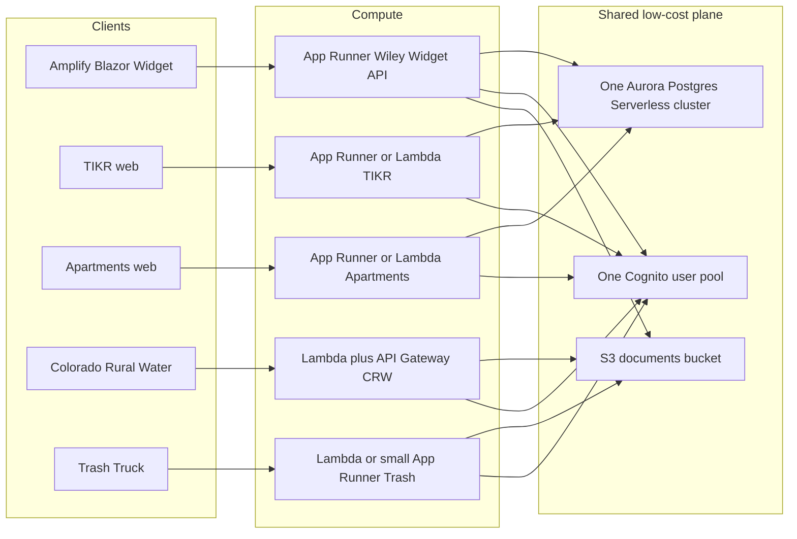

# AWS low-cost architecture (four-system suite)

How to host the Town of Wiley application suite on AWS while keeping **monthly cost roughly under $50–80** at current (low) volume.

Audience: operators and agents planning infra for Wiley Widget, TIKR, Wiley Apartments, Colorado Rural Water, and Trash Truck. This is an architecture target, not a deploy runbook.

Status date: 2026-11-08.

Related: [`post-production-operations-handbook.md`](post-production-operations-handbook.md), [`shared-contracts-agent-suggestions.md`](shared-contracts-agent-suggestions.md), Cognito notes in [`production-completion-plan.md`](production-completion-plan.md).

## Goals

- One **shared** data/auth/document plane where it is cheap and safe.
- Prefer **serverless or scale-to-near-zero** compute.
- Reuse the **existing** Wiley Widget App Runner + Aurora pattern; do not invent a second cloud stack.
- Stay under about **$50–80/month** for the whole suite at municipal traffic (staff users, occasional public hits), excluding one-off build minutes and xAI/third-party API usage.

## Platform constraint (App Runner)

AWS states **App Runner is closed to new customers after 2026-04-30**. Existing customers (including the current Wiley Widget service) can keep operating.

Implication for this suite:

- **Wiley Widget:** keep the current App Runner service.
- **TIKR / Apartments / Trash Truck:** prefer **another App Runner service in the same AWS account** only if that account remains eligible as an existing App Runner customer. If a new App Runner service cannot be created, use **Lambda** (preferred for thin APIs) or a **single small ECS Fargate** service as the fallback. Do not open a second AWS account just to get App Runner.

Treat App Runner successor review (Fargate / other) as a standing follow-up; do not block the low-cost plan on a rewrite of Wiley Widget.

## Target account and region

| Preference | Choice |
| ---------- | ------ |
| Account | Town of Wiley official (`tow`, account id starts with `818…`) for municipal workloads |
| Region | `us-east-2` (match Wiley Widget today) |
| Avoid | Spreading the suite across Steve personal (`570…`) and Town (`818…`) without a clear cutover plan |

Confirm with `aws sts get-caller-identity --profile tow` before creating resources.

## System-by-system plan



### 1. Wiley Widget (financial hub)

**Keep the existing pattern.**

| Layer | Choice |
| ----- | ------ |
| Client | Amplify Hosting (static Blazor WASM) |
| API | App Runner (`wiley-widget-api` class of service), small CPU/memory |
| DB | Aurora PostgreSQL Serverless (existing cluster) |
| Auth | Cognito staff pool (already in use) |
| Secrets | Secrets Manager + SSM as today |
| Contracts | `shared-contracts/` + `/api/reference-data/*` ingest (no new paid service) |

Do not migrate Wiley Widget off App Runner for cost alone while the service is healthy. Do not add a second database for reference-data documents; they already use Aurora.

### 2. TIKR and Wiley Apartments

**Repos:** TIKR already ships multi-stage `docker/Dockerfile.api` + `Dockerfile.web`, Synology `docker-compose.prod.yml` (SQLite), and Aurora-oriented `docker/docker-compose.prod.postgres.yml` + `docker/PRODUCTION-AURORA.md`. Wiley Apartments ships root/`deploy/Dockerfile`, Synology SQLite compose, and `deploy/docker-compose.prod.yml` + `deploy/PRODUCTION-AURORA.md` (Postgres via `ClerkSuite__DatabaseProvider`). Local/NAS SQLite remains the default when Provider is unset or `Sqlite`.

**Containerize with Docker.** Run on:

1. **App Runner** (same account, if still creatable), **or**
2. **One shared ECS Fargate service** with two task definitions / two target groups only if App Runner is unavailable and two Lambdas are a poor fit (long-lived connections, heavy frameworks).

**Data:** move each app’s **SQLite → Postgres** on the **same Aurora cluster** as Wiley Widget (separate databases or schemas: e.g. `tikr`, `apartments`). Prefer schemas/databases on one cluster over a new RDS instance.

| Do | Do not |
| -- | ------ |
| One Docker image per app, small footprint | Dedicated RDS Postgres per app |
| Share Aurora; isolate by database/schema + IAM/secrets | Multi-AZ readers “for best practice” at this volume |
| Public HTTPS via App Runner / ALB only if required | Private subnets that force **new NAT gateways** |

If both apps are low traffic and request/response oriented, **Lambda + Function URL or API Gateway** can undercut Fargate; use containers only when the runtime needs a persistent process.

### 3. Colorado Rural Water

**Leave on Lambda + API Gateway + S3 + Cognito** (already serverless).

- No App Runner / ECS for CRW unless a concrete limitation appears.
- Store documents and static assets in the **shared S3** prefix or bucket.
- Join the **shared Cognito** pool via an app client (or federation later); do not create a second pool “for CRW only.”

### 4. Trash Truck

**Wrap as Lambda** first (API Gateway HTTP API or Function URL).

- Fall back to a **small App Runner** service only if the workload needs a long-running process, large binary deps, or WebSockets that Lambda cannot host cheaply.
- Persist operational data in Aurora (shared cluster) or S3 depending on shape; prefer S3 + Postgres over SQLite-on-EFS.

### 5. Shared services (suite-wide)

| Service | Role |
| ------- | ---- |
| **One Cognito user pool** | Staff (and later limited public) identity; per-app clients / groups for Widget, TIKR, Apartments, CRW, Trash |
| **One Aurora Serverless Postgres cluster** | Widget + TIKR + Apartments (+ Trash if relational); separate DBs/schemas |
| **One S3 bucket** (or one bucket with prefixes) | Documents, exports, council packets, CRW assets |
| **ECR** | Images for Widget / TIKR / Apartments (and Trash if containerized) |
| **CloudWatch** | Logs + a few alarms; no paid observability suite |
| **Secrets Manager / SSM** | Per-app secrets; no secrets in git |

**Networking:** reuse the existing Aurora VPC path / App Runner VPC connector already used by Wiley Widget. Prefer **public App Runner / Lambda in the same region** over new private subnet designs that require NAT.

**Cross-system data:** exchange via `shared-contracts` JSON (file drop to S3 or HTTPS POST to Widget `/api/reference-data/*`). No shared OpenSearch, no EventBridge bus required for v1.

## What we will NOT do

Explicit exclusions to protect the $50–80 target and operational simplicity:

- **No separate VPC per system** (no mesh of peering / Transit Gateway for this suite).
- **No new NAT gateways** unless a hard requirement appears; NAT alone can exceed the monthly budget.
- **No provisioned Aurora / RDS instance classes** “for headroom” while Serverless meets load.
- **No multi-AZ Aurora / multi-AZ ALB** unless compliance or an outage post-mortem requires it.
- **No new OpenSearch / Elasticsearch** domain.
- **No ElastiCache / Redis** until a measured need exists.
- **No always-on EC2** jump boxes or app hosts.
- **No second Cognito user pool** per app (use app clients / groups on one pool).
- **No dedicated RDS Postgres** for TIKR or Apartments (use shared Aurora).
- **No SQLite as the production system of record** after cutover (dev-only OK).
- **No new paid AI / search / analytics SaaS** in this architecture doc (xAI usage is tracked separately from AWS infra).
- **No App Runner image as long-term file storage** for imports (use S3).

## Rough monthly cost estimate (USD, `us-east-2`)

Assumptions (current municipal volume):

- Staff-scale traffic, not viral public load.
- Aurora Serverless v2 with **low minimum ACU** (0 or 0.5 when auto-pause / low min is available and safe for the engine features in use). Shared by Widget + TIKR + Apartments.
- One App Runner service for Widget at ~0.25–0.5 vCPU / 0.5–1 GB, often idle.
- Zero or one additional App Runner (or equivalent Lambda) for TIKR/Apartments/Trash.
- Cognito well within free-tier MAUs.
- S3 storage under ~20 GB; negligible request cost.
- **Excludes** xAI / Syncfusion / domain registrar / Amplify build overages / data transfer surprises / support plans.

Prices below are **order-of-magnitude planning numbers** (list price ballpark). Re-validate in AWS Pricing Calculator and Cost Explorer before committing.

| Line item | Low month | Likely month | Notes |
| --------- | --------- | ------------ | ----- |
| Aurora Serverless v2 (shared) | $15–35 | $25–45 | Dominates the bill. Use min ACU 0 (auto-pause) or 0.5; avoid Performance Insights if it forces higher min ACU. Storage GB small. |
| App Runner (Wiley Widget API) | $3–8 | $5–12 | Small CPU/memory; cost rises if min instances kept warm 24/7. |
| App Runner or Lambda (TIKR + Apartments) | $0–8 | $2–10 | Lambda often cheaper at low QPS; App Runner if grandfathered and simple. |
| Lambda + API Gateway (CRW + Trash) | $0–3 | $1–5 | Usually free-tier / near-zero at town volume. |
| Amplify Hosting (Widget client + static sites) | $0–5 | $1–8 | Hosting cheap; watch build minutes. |
| Cognito | $0 | $0 | Free tier MAUs typically cover staff + light public. |
| S3 documents | $0–2 | $0–3 | Storage + PUT/GET for packets/exports. |
| ECR + CloudWatch Logs | $1–4 | $2–6 | Image storage + log retention; trim retention to 7–14 days. |
| Secrets Manager / SSM | $1–3 | $1–4 | Few secrets; prefer SSM Parameter Store where acceptable. |
| **Suite total (infra)** | **~$20–55** | **~$40–80** | Fits target if Aurora min ACU stays disciplined and NAT/OpenSearch stay off the table. |

### Budget killers (avoid)

| Item | Why it breaks the target |
| ---- | ------------------------ |
| NAT Gateway (~$32+/month each + data) | Can consume the entire budget alone. |
| Aurora min ACU stuck at 2+ (e.g. for Performance Insights) | Multiplies DB cost. |
| Always-on Fargate tasks sized for peak | Idle burn. |
| Multi-AZ “default” for every data store | Roughly doubles DB cost without demand. |
| Separate RDS per app | Fixed floor per instance. |

### Cost control habits

- Tag all suite resources with `Project=tow-suite` (and per-app `App=…`) for Cost Explorer.
- Set an AWS Budget alarm at **$80** and **$100**.
- Review Aurora `ServerlessDatabaseCapacity` / ACU utilization monthly; lower max ACU if never approached.
- Keep CloudWatch log retention short.
- Prefer S3 lifecycle rules on document prefixes (e.g. expire scratch uploads).

## Terraform (Widget + Apartments first)

Low-cost, **destroyable** footing lives in [`infra/terraform/`](../infra/terraform/README.md):

- AWS Budgets at **$80** / **$100** (email kill-switch)
- Private S3 drop bucket for `shared-contracts/`
- ECR repos for Widget API + Apartments (`force_delete` so `terraform destroy` works)
- Optional SSM parameters for Widget ingest URL

```bash
cd infra/terraform
cp terraform.tfvars.example terraform.tfvars   # set budget_alert_emails
./scripts/plan-apply.sh --apply
# if costs climb:
./scripts/destroy.sh
```

Does **not** create NAT, Aurora, or new App Runner. Existing Widget App Runner / Aurora stay outside this state.

## Cutover sketch (order)

1. Confirm account (`tow`) + region (`us-east-2`) + App Runner eligibility for new services.
2. Apply `infra/terraform` (budgets + contracts S3 + ECR); keep Widget as-is.
3. Create Cognito app clients for sibling apps.
4. Add Aurora databases/schemas for TIKR and Apartments; migrate off SQLite.
5. Deploy TIKR / Apartments containers (or Lambda) against shared Aurora.
6. Point CRW and Trash at shared Cognito + S3; keep CRW Lambda stack.
7. Exchange data with Widget via `shared-contracts` (S3 drop or `/api/reference-data/*`).

## Successor note

If App Runner must be vacated later, the low-cost successor for Widget is likely **ECS Fargate behind an ALB** or **Lambda** for the thin API, still on the same Aurora cluster. Revisit only when AWS or cost forces the move; do not dual-run two full stacks.
